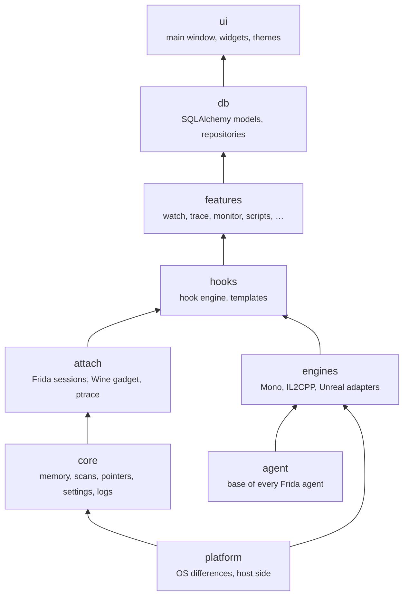

# Architecture

Grembyte is a PySide6 application in one Python package, `grembyte`. The code that runs inside the game is JavaScript for [Frida](https://frida.re), kept in `.js` files beside the Python module that loads it.

## Packages

The packages form layers; each depends only on the layers below it.

| Package | Contents |
| --- | --- |
| `grembyte/agent` | What every agent builds on: loading agent sources (`source.py`), errors in the user's language (`messages.js`), what differs between Linux and Windows inside the game (`platform.js`). Imports nothing else from Grembyte. |
| `grembyte/platform` | Grembyte's own side of a process: reading memory and mappings, process facts (`linux.py`, `windows.py`), PE images of Wine processes (`wine.py`). |
| `grembyte/core` | Memory access, the value scanner, pointer chains and value types; settings, logs, the activity log and the session registry. |
| `grembyte/attach` | Getting into a process: Frida sessions (`frida_attach.py`), the Wine gadget and its Windows helper (`wine_gadget.py`, `wine_helper.py`, `inject/`), shared ptrace machinery (`ptrace_engine.py`), the watch backend names. |
| `grembyte/engines` | One adapter per engine (`mono/`, `il2cpp/`, `unreal/`), each with a Python adapter and its agent; `registry.py` combines them into the engine agent the features load. |
| `grembyte/hooks` | The hook engine (`engine.py` + `engine.js`), the ptrace hook, the built-in manipulations and templates (`transforms.py`), the script sandbox. |
| `grembyte/features` | The tools: write watch, freeze, catalog, trace, native trace, monitors, method hooks and calls, scripts, favorites, call graph. |
| `grembyte/db` | SQLite through SQLAlchemy: models and repositories, export and import. |
| `grembyte/ui` | The main window, widgets, localization, themes, icons. |

## Agents

A feature's agent is put together from parts: the platform helpers (`agent/platform.js` with `agent/messages.js`), the engine prelude, every engine adapter's agent, the engine facade, and the feature's own script. The engine adapters register themselves; the facade picks the one whose runtime the game has loaded, so features use one `engine` object whatever the engine.

Under Wine/Proton the agents run in Frida's Windows gadget. The gadget drops messages larger than 128 KiB, so `attach/frida_attach.py` sends larger agents in parts.

## Built-in hook templates

The example templates (Multiplier, Fixed value, Clamp and the method templates) come from subclasses of `ValueTransform` in `grembyte/hooks/transforms.py` whose `kind` is in `EXAMPLE_TEMPLATE_KINDS`. If an example is missing at start (same seed key or name), Grembyte creates it. Name, description and parameter labels come from `EXAMPLE_TEXTS` in the same file, under `<kind>`, `<kind>.description`, `<kind>.<parameter>` and `choice.<value>`; where they are missing, `title`, the parameter name or the choice value is used. Examples created by earlier versions with German names are renamed through `GERMAN_EXAMPLE_TEXTS`. Manipulations of your own do not need this: they are created as templates directly in the interface.

## Adding an engine

1. Add a subpackage under `grembyte/engines/` with an `EngineAdapter` subclass (see `engines/base.py`) and an `agent.js` that registers itself with `registerEngine(...)`.
2. List the adapter in `ENGINES` in `engines/registry.py`; the order is the order in which the agent looks for runtimes.
3. Declare its capabilities; the UI enables the tools the adapter supports.

The [roadmap](https://github.com/grembyte/grembyte/blob/main/ROADMAP.md) discusses candidates such as Godot, Lua engines, RPG Maker and Ren'Py.
