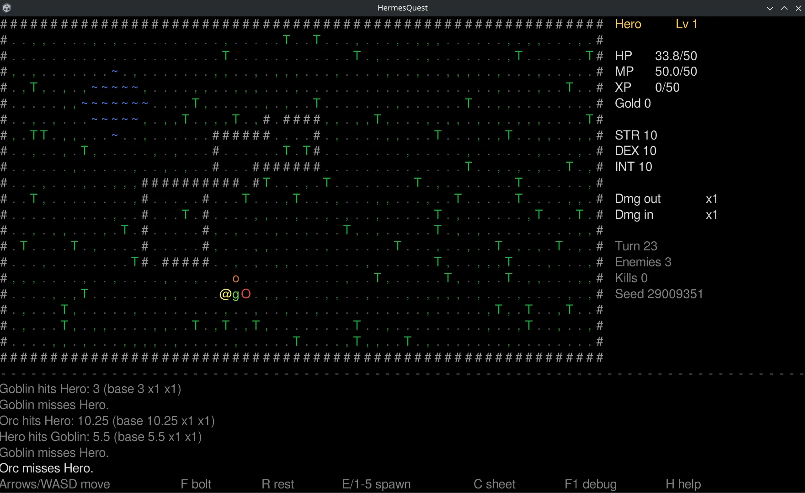

# HermesQuest

HermesQuest is a small role-playing game made for trying out Hermes Hook. It is a Unity game with the Mono backend, so every tool works on it: value scans, pointer scans, the write watch, value hooks, and the [Unity (Mono)](../engines/unity-mono.md) tools – catalog, trace, method monitor, method hooks and scripts. The examples in this section all use it.

It is deliberately built like a real game: the values live in heap objects behind pointers, "New game" moves them to new addresses, player and enemies share one class, and all damage goes through one pipeline that hooks and scripts can change.

## Download

| System | Download |
| --- | --- |
| Linux (native, x86-64) | [HermesQuest-RPG-Linux](https://github.com/winterhafen/hermes-hook/releases/download/v0.5.0-alpha/HermesQuest-RPG-Linux) |
| Windows, or Linux under Wine/Proton | [HermesQuest-RPG-Windows.zip](https://github.com/winterhafen/hermes-hook/releases/download/v0.5.0-alpha/HermesQuest-RPG-Windows.zip) |

Both are zip archives with the game folder in them. The Linux file has no `.zip` extension, but unpacks the same way.

=== "Linux"

    ```bash
    unzip HermesQuest-RPG-Linux -d HermesQuest
    ./HermesQuest/Linux/HermesQuest.x86_64
    ```

    In Hermes the game shows up as `HermesQuest.x86_64`. Remember the [permissions](../getting-started/permissions.md): with `kernel.yama.ptrace_scope` at `1`, Hermes cannot reach a game it did not start.

=== "Windows"

    Unpack `HermesQuest-RPG-Windows.zip` and start `Windows\HermesQuest.exe`. In Hermes it shows up as `HermesQuest.exe`.

=== "Under Wine/Proton"

    The Windows build is also the test case for [Wine and Proton](../wine-proton.md):

    ```bash
    unzip HermesQuest-RPG-Windows.zip -d HermesQuest
    wine ./HermesQuest/Windows/HermesQuest.exe
    ```

    or add `HermesQuest.exe` to Steam as a non-Steam game and start it with Proton. The first time you select it, Hermes offers to download Frida's Windows gadget.

`-seed <n>` on the command line fixes the map and every roll, also after "New game", so a run can be repeated exactly:

```bash
./HermesQuest/Linux/HermesQuest.x86_64 -seed 42
```

<figure markdown="span">
  
  <figcaption>HermesQuest: the player <code>@</code> fighting a goblin and two orcs, the character on the right, the message log with every hit and its multipliers below.</figcaption>
</figure>

## Playing

| Key | Action |
| --- | --- |
| Arrows, WASD, numpad | Move; walk into an enemy to attack it |
| Space / R | Wait / rest (recover 2 health) |
| F | Fire Bolt at the nearest enemy, costs 7.5 mana |
| E, 1–5 | Spawn a random enemy / a rat, goblin, skeleton, orc or ogre |
| Delete | Remove all enemies |
| C | Character sheet |
| F1 | Debug view with the exact values and the process ID |
| H | Help |
| N | New game |

Enemies only appear when you spawn them, so you decide when a fight starts. Killing one brings experience and gold:

| Enemy | Key | Health | Experience | Gold |
| --- | --- | --- | --- | --- |
| Rat | 1 | 6 | 4.5 | 0–2 |
| Goblin | 2 | 12 | 10.25 | 3–8 |
| Skeleton | 3 | 18 | 15.5 | 2–10 |
| Orc | 4 | 28 | 24.75 | 8–20 |
| Ogre | 5 | 60 | 60 | 20–45 |

The **F1** view shows every value with all its decimal places – handy to check what a scan should find – and the process ID to pick the right process in Hermes.

## How the game is built

This is what the examples rely on. All code is in the namespace `HermesQuest`; the catalog shows it in the assembly `Assembly-CSharp`.

### The values

```text
GameState.Current            static field: the running game
  └─ Player                  Character
       ├─ Stats              CharacterStats
       │    ├─ Level         int
       │    ├─ Strength, Dexterity, Intelligence   int
       │    ├─ Health, MaxHealth                   float
       │    ├─ Mana, MaxMana                       float
       │    ├─ Experience                          double
       │    └─ Gold                                int
       ├─ DamageOutgoingMultiplier                 float, 1.0
       └─ DamageIncomingMultiplier                 float, 1.0
```

- The player starts with 50 health, 50 mana, 0 experience and 0 gold.
- **Mana regenerates by 0.13 per second** in real time, also while the game is in the background. A value that changes on its own is a good test for scans with tolerance.
- **Experience is a double** with decimals (a goblin brings 10.25), shown rounded on the character sheet.
- **New game** builds a new `GameState` with a new player and new stats: all addresses change, as after loading a save game in a real game.

### The damage pipeline

Melee attacks and Fire Bolt, of the player and of enemies, all go through the same methods:

```text
Combat.MeleeAttack / Combat.CastFireBolt
  └─ Combat.ApplyDamage(game, attacker, target, baseDamage, source)
       ├─ Combat.CalculateDamage(attacker, target, baseDamage)
       │      returns baseDamage × attacker.DamageOutgoingMultiplier
       │                         × target.DamageIncomingMultiplier
       └─ Character.TakeDamage(amount)      writes target.Stats.Health
```

- Player and enemies are both `Character`; `IsPlayer` tells them apart. A hook on `TakeDamage` therefore hits everyone unless it checks `IsPlayer`.
- The message log shows base damage and multipliers of every hit, and the F1 view the last calculation, so you see at once what a hook or script changed.
- Every method that writes a value has a method of its own: `TakeDamage`, `Heal`, `SpendMana`, `RegenerateMana`, `AddGold`, `AddExperience`. They are compiled without inlining, so each is a separate function in memory that the write watch names and that a hook can catch.

## The examples

1. [Scans and pointer scan](hermesquest-scans.md): find gold, mana and experience, and a pointer chain that survives a new game.
2. [Hooks](hermesquest-hooks.md): multiply gold at the instruction that writes it, protect the player but not the enemies, change damage with method hooks.
3. [Scripts](hermesquest-scripts.md): read and change the character from JavaScript, heal on a timer, scripts with parameters.
4. [JavaScript in Hermes](javascript.md): the language as far as hooks and scripts need it, explained along the examples.

If you have never used Hermes, do the [tutorial](../getting-started/first-hook.md) with the small C test game first; it explains the main window step by step.
