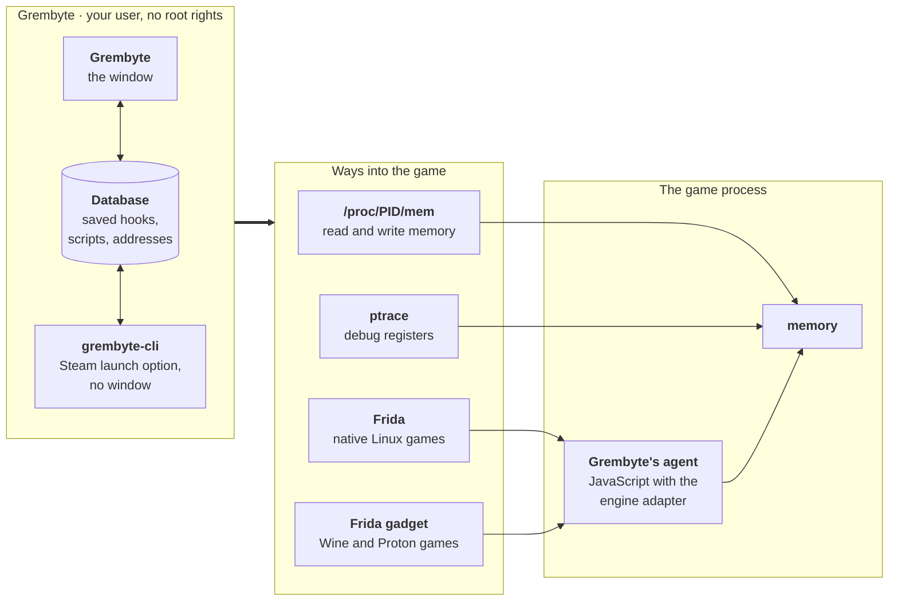

# How Grembyte works

Grembyte runs as a program of its own, beside the game. It never changes the game's files: everything happens in the game's memory while it runs, and is gone when the game exits. This page shows the parts involved and how they reach the game; the other pages go into the details.

## The parts

**Grembyte**, the window, is where you work: scanning for values, setting up hooks and scripts, exploring a game's classes and objects. What you set up is saved for the game in Grembyte's database (see [Files and environment](../reference/files.md)).

**grembyte-cli** starts a game from Steam and installs the hooks and scripts saved for it, without a window (see [Starting games with grembyte-cli](../guide/launch-option.md)). Hotkeys run its scripts in the game. While it runs a game, the window can take the game over to change something and hand it back.

**The game** runs as usual. Grembyte only reaches into its memory, through one of four ways. Each feature uses one of them, and only while you use it.

## The ways into the game

| Way | What it is | Used for |
| --- | --- | --- |
| **`/proc/<pid>/mem`** | Linux shows the memory of every process as a file; a program allowed to may read and write it. | [Scans](../guide/scanning.md), [tracked addresses](../guide/addresses.md), the [pointer scan](../guide/pointer-scan.md), the memory viewer |
| **[Frida](https://frida.re)** | A toolkit that loads a small *agent* into a running program: JavaScript that runs inside the game and can watch and call its code. Grembyte's agent knows the engines (Unity Mono and IL2CPP, Unreal), so it can name classes, objects and methods. | [Hooks](../guide/hooks.md), [scripts](../guide/scripts.md), the [native trace](../guide/native-tools.md) and all [engine tools](../engines/index.md): catalog, object browser, method hooks, call and reference graphs |
| **Frida gadget** | Frida in the form of a Windows DLL. Windows games under Wine or Proton get it instead of the plain Frida, since that crashes them; it then runs Grembyte's agent the same way. It listens on `127.0.0.1` only. | The same as Frida, for Wine and Proton games (see [Wine and Proton](../wine-proton.md)) |
| **ptrace** | The interface of Linux that debuggers such as gdb use. Grembyte uses the CPU's debug registers through it: they report when an address is written, without putting anything into the game. | The [write watch and hooks](../guide/write-watch.md#backends-frida-or-ptrace) with the ptrace backend, and 32-bit Wine/Proton games |

All four act only on processes of your own user, and Linux allows them only where *tracing* is allowed: see [Permissions](permissions.md). Grembyte connects to nothing on the network, apart from downloading the gadget when you agree or have switched automatic downloads on.
